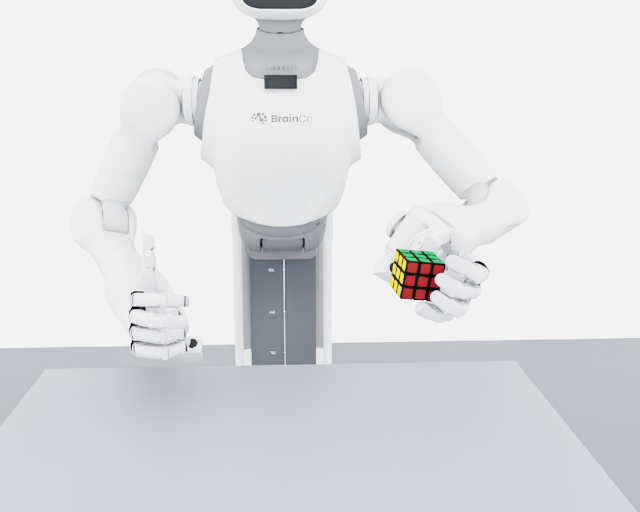
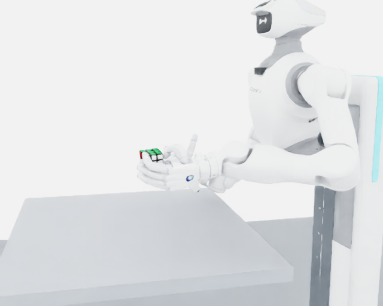

# Issue #1 / #2 / #3 实施记录（2026-11-03）

当前默认 `tilt-teacher` 已切换到左肘外展 teacher。#1 有新完整 PhysX 独立验收；#3 有隔离离线验收。#2 仍是开发路径，不能称为完整双手交接通过。

## #1 左肘外展

保留 v20 左手桌面主抓。离桌后通过肩臂关节把持物点移到同侧工作区，再执行整块 −90° 翻转。`elbow_handover.py` 对实际肩（Link2_L）到肘（Link4_L）的方向增加外展约束，仍通过原 56 维软/硬限位、目标变化和速度安全层、PD/PhysX。没有绑物或写回物体位姿。

根坐标 +Y 是机器人左侧。记录肩/肘/腕实测位置：`outward = elbow.y − shoulder.y`；上臂外展角为 `atan2(outward, shoulder.z − elbow.z)`；另记录肘相对肩—腕轴的外侧偏移。验收门槛为外侧至少 16 cm、角度至少 35°。IK 目标为 18 cm，而不是仅比较左右肘顺序。

`elbow_gate.py` 从位置重新计算指标，要求姿态、五指正确面接触、抬升 ≥8 cm、误差 ≤5°、线速度 <0.03 m/s、角速度 <0.20 rad/s 同时连续至少 3 秒；全回合无碰桌、自碰、限位或掉落。垂直肘即使伪造汇总指标也不能通过。

| 冻结后独立 seed | 最终外展角 | 最终抬升 | 同时合格保持 |
|---|---:|---:|---:|
| 9601 | 39.14° | 23.71 cm | 3.03 s |
| 9602 | 39.08° | 23.87 cm | 3.03 s |
| 9603 | 39.17° | 23.48 cm | 3.03 s |
| 9604 | 39.22° | 23.46 cm | 3.03 s |
| 9605 | 39.17° | 23.60 cm | 3.00 s |

独立 5/5；开发 seed 9501 完整回合及录像回归另计。两组碰撞累计冲量均为 0，无掉落与限位命中。最小实测软限位余量在 9601 为 0.405°，不能理解为所有关节均远离边界。9601–9605 今后均为已见种子。




[实际控制录像](evidence/issues_123/elbow_out_demo.mp4)来自 `elbow_out_visual_v1_20261103`，没有用位姿回放计算成功率。证书：`revotron_cube_rl/elbow_out_gate_certificate.json`。源码、配置、资产和轨迹 SHA256 均保留。协议只冻结控制/物理源文件；迁移解析器清单是单独审计的元数据，run 中原始元数据快照保持不变。传统 teacher 无神经 checkpoint，本次没有 BC/PPO 训练。

```bash
source activate.sh
bash revotron_cube_rl/run_linux.sh tilt-teacher --name new_elbow_demo --seeds 9501 --record
bash revotron_cube_rl/run_linux.sh elbow-check --out /tmp/elbow_certificate_reaudit.json
```

## #2 右手接抓：开发中

原 mirrored 同面接抓在新的左肘构型下会出现两手小指重叠；不能直接复用旧交叉姿态。新候选把右手拇指/四指落在相邻一组面，在保持左肘外展的情况下调整持物位置，并加入不同手指之间及预抓/靠近/闭合整条路径的网格检查。

发现两处腕连接件 CollisionAPI/MeshCollisionAPI 位于普通 Xform 上。新增 `revotron_bimanual_revo3_wrist_mesh_v1.usda` 包装层将 API 附着到原 Mesh，原 USD 不改动；网格点/面索引/变换及过滤对均不变，清单为 `wrist_collision_manifest.json`。依据 [NVIDIA MeshCollisionAPI 要求](https://nvidia.github.io/simready-foundation/2026.04.1/capabilities/physics_bodies/physics_rigid_bodies/requirements/physx-collider-mesh.html)。这是 schema 修正，尚不能宣称解决了接抓物理碰撞。

该包装层下 seed 9501 的完整左手回归通过，记录为 `wrist_schema_left_regression_v1_20261103`；它不是新的独立种子，也不证明右手接抓。

`safe_handover_v2_dev_20261103` 完整从 reset 执行到左手外展、翻转和对准，右手预抓 IK 不可行而停止：0 自碰/碰桌冲量，右手接抓未成功。离线候选还暴露了预抓插值时无名指/小指间距低于 3 mm。失败保留，不降低门槛。

最新 `safe_handover_v3_regrasp_guard_20261103` 完整从 reset 开始，左手对准后在执行右手动作前检查了 1450 个路径采样，闭合阶段第 75 步的右食指 DIP / 左小指橡胶网格间距为 2.928 mm，低于 3 mm 预检门槛，因此拒绝整条右手计划；实测自碰和碰桌冲量均为 0。不能把“被预检拦住”记为接抓成功。`safe_handover_v3_guard_20261103` 实际没有传 --regrasp，属于左手对准回归（1/1），不是右手接抓实验。

已分别检查同时闭指、小指先闭和其余四指先闭的候选；当前末端姿态可以静态通过，但中间路径仍不通过。右手执行时取消原独立指尖追踪对已检查名义目标的覆盖；缺接触时保持门失败，不用未审查的手指修正凑接触。实际起点到首个目标、关节间插值、右手指限位也加入了预检回归测试。当前离线单元测试共 56/56。补充实际起点检查后，对保存的失败计划离线重算 1452 个采样，仍在同一位置以同一 2.928 mm 间距拒绝（不是新增物理回合）。

[最新失败路径预检](evidence/issues_123/last_regrasp_path_audit.json)和完整 `rejected_or_checked_right_plan_9501.json` 均保存。当前 #2 仍待重新优化接触落点/路径及通过完整物理独立验收。

`tilt-teacher --regrasp` 显式进入 `safe_handover_experiment.py` 开发路径及修正腕部资产。成功的末端 IK 或几何间距不能代替完整物理回合、双手 3 秒保持和 ≥5 个新独立 seed。右手独立持物/左手释放仍未验证；此路径不解锁 DAgger/PPO 或转层。

## #3 证据迁移

六个 gate 使用 `evidence_paths.py` 统一受约束解析：历史绝对路径是标识符，映射到本克隆相同组件；缺失本地证据不回退旧工作区。可显式设置 `RL_CUBE_EVIDENCE_ROOT=/path/to/project-shaped-evidence`（其中有 `runs/`），资产仍从当前工作区读取。拒绝 `..`、未映射绝对路径、逃逸符号链接及未下载 LFS 指针。

原证书字节保持不变。`portability_migration.json` 保存原证书、原/新 gate 和解析器 SHA256，`certificates/legacy_source/` 保存原 gate 源码。历史 side 证书把自身 gate 源码纳入哈希，因此只有这一项允许经原证书/原快照/新解析器清单全部校验后的显式迁移；控制、物理和配置哈希不豁免。

`validate_relocated_evidence.py` 复制已发布证据到另一临时目录，在独立 Python 子进程中通过 audit hook 拒绝打开原工程/资产/实验目录；新副本通过三层前置门禁和六回合离线重算，没有尝试读回旧目录。该隔离作用于被测 Python 文件访问，不声称做了整个系统的 OS mount 隔离。

18 项检查通过，包括源码/配置/runtime 配置/资产/轨迹/gate/旧解析器/解析器/协议/证书篡改、缺失轨迹、LFS 指针、重复 seed 和协议缺回合的拒绝测试。结果为 [relocation_validation.json](evidence/issues_123/relocation_validation.json)。这是旧证据的离线重算，新增 PhysX 回合数为 0，不扩大历史验收。

```bash
python revotron_cube_rl/validate_relocated_evidence.py --out /tmp/relocation_validation.json
bash revotron_cube_rl/run_linux.sh evidence-check --out /tmp/portable_evidence.json
```

本轮真实 PhysX 与离线重算分开记录。没有完成右手交接、神经视觉策略、单层转动、完整复原或实机验证。
