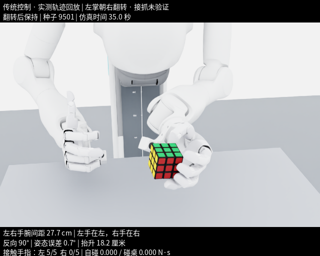

# 左掌朝右翻转修正与未完成姿态要求

本次同步的是传统状态反馈 teacher 的整块魔方翻转，尚未完成右手接抓。用户最新指出：**左手肘应朝外，当前演示朝内**。该要求尚未修复，现有 3/3 结果不代表左肘姿态已经验收。



[35.2 秒实测轨迹演示](evidence/palm_direction_v5/demo.mp4) · [证据与路径索引](evidence/palm_direction_v5/index.json) · [原始验收证书](../revotron_cube_rl/palm_direction_gate_certificate.json)

## 已验证范围

原 v20 左手抓起后，整个魔方反向转 90°，左掌朝向机器人右侧，左右腕和肘不交换左右侧。翻转过程中保持原手指刚度；结束后减小刚度并通过有幅度限制的关节目标反馈修正滑移。软硬限位、速度与接触检查仍保留。

| 新独立 seed | 最终角误差 | 最终抬升 | 合格连续保持 | 自碰/碰桌累计冲量 |
|---|---:|---:|---:|---:|
| 9501 | 0.716° | 18.22 cm | 3.03 s | 0 / 0 N·s |
| 9502 | 0.666° | 18.35 cm | 3.00 s | 0 / 0 N·s |
| 9503 | 0.567° | 18.13 cm | 3.03 s | 0 / 0 N·s |

开发回归 9301、9402、9403 为 3/3；独立测试 9501–9503 为 3/3。全部从桌面 reset 开始，左手五指真实接触，无软硬限位命中或掉落。初始 XY 各 ±15 mm、偏航 ±0.15 rad，不能推及所有摆放位置。运行记录在 `revotron_cube_rl/runs/palm_direction_<seed>_v5/`，原始配置、源码、轨迹和哈希均保留。

这些 PhysX 回合在原工作区运行，使用 3 个隔离进程、每进程 1 个 CPU 物理环境，RTX 5070 Laptop 8 GB 用于渲染。本次发布同步不启动或重跑 Isaac；后续在本仓库运行实验遵守 AGENTS.md 的单进程约定。演示由实际轨迹回放生成，成功率不来自回放。

## 未验收与失败记录

- **左肘外展未验收。** 现有检查只包括掌心方向、腕/肘左右顺序和躯干避碰，没有肩—肘—腕构型的外展或 swivel 目标。`palm_direction_gate_certificate.json` 的 `passed` 只针对其原有翻转/保持范围。
- **右手完整接抓未通过。** `palm_facing_dev_v1` 在 step 1437 出现左右腕部自碰，累计冲量 0.083815 N·s；`palm_facing_resume_v4_spacing` 在 step 47 出现右食指/中指自碰，0.184858 N·s。后者是恢复状态调试，不能计入独立成功率。两个 run 的原始源码、结果和轨迹已收录。
- 旧 v19 的方向和交叉姿态已被用户否定，其当前任务证书置为不通过，历史物理证书另存。更早的失败和候选协议也保留为历史，不属于当前已验收动作。
- 没有新 PPO 训练、右手单独持物、内部转层或实机验证。传统 teacher 不产生新的神经网络 checkpoint。

## 复现入口

```bash
# 使用已安装的兼容 Isaac Python；每次使用新的 run 名称
bash revotron_cube_rl/run_linux.sh tilt-teacher --name palm_direction_new --seeds 9601
bash revotron_cube_rl/run_linux.sh tilt-replay --run revotron_cube_rl/runs/palm_direction_new --seed 9601
```

默认 `tilt-teacher` 仅运行左手翻转与保持。显式 `--regrasp` 仍是未通过验收的开发路径，不应进入后续 PPO/DAgger 主线。已经查看过的 seed 只能用于开发回归。

证书中的原机绝对路径保持原样，以保留历史哈希；`docs/evidence/palm_direction_v5/index.json` 提供仓库内路径映射。发布时会在仓库目录验证文件哈希和重算所选轨迹的原有验收，但运行时所有门禁的跨目录解析仍需修复，不应通过关闭哈希校验解决。

## GitHub 问题跟踪

- [[P1] 左手肘应朝外：增加外展构型约束与姿态验收](https://github.com/milet-vidon/rl_cube/issues/1)
- [[P1] 修复右手接抓中的腕部与相邻手指碰撞](https://github.com/milet-vidon/rl_cube/issues/2)
- [[P0] 修复验收证书与实验路径的跨工作区解析](https://github.com/milet-vidon/rl_cube/issues/3)
