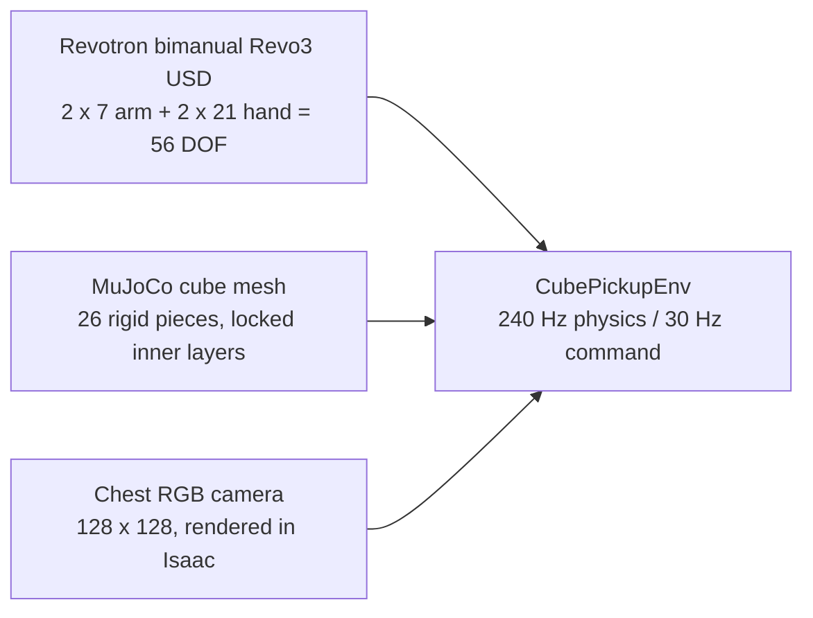
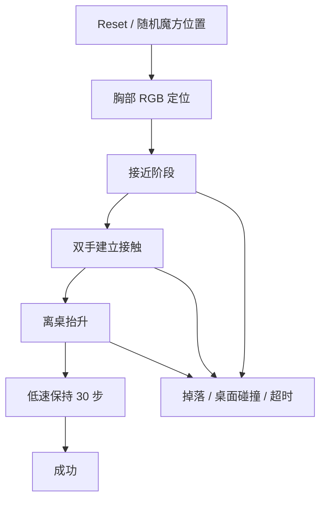
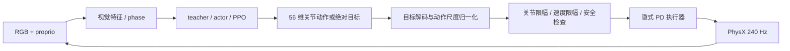
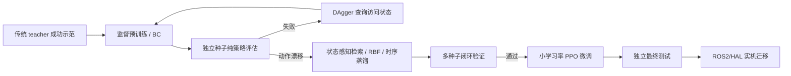
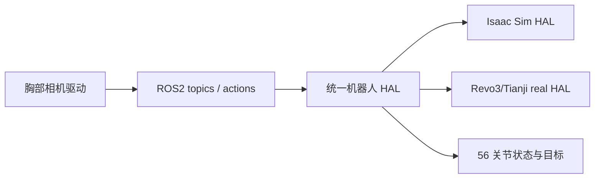

# 双臂 Revo3 + Tianji 魔方强化学习框架链路

当前工程把“视觉确定魔方位置”和“传统低层控制”分开。策略只产生 56 维双臂双手目标，Isaac 环境负责关节限幅、PD 和物理碰撞；训练时才额外给 critic 使用特权状态。

## 1. 场景与资产



资产路径通过 `REVOTRON_USD_PATH` 和 `ISAAC_MUJOCO_CUBE_ROOT` 配置，不把 Windows 盘符写进控制逻辑。

## 2. 观测合同

每个 30 Hz 控制周期，环境产生两条信息流：

1. **actor 可用信息**：胸部 RGB，以及 224 维本体觉：
   - `q - q_home`：56
   - `0.1 * qdot`：56
   - 上一步已执行动作：56
   - 当前 `target - q`：56
2. **critic / 审计信息**：魔方位姿和速度、双掌相对位置、接触冲量、持稳进度等特权量。它们不能进入 actor 推理路径。

视觉阶段目前有三种模式：

- 原始 RGB actor：直接输入图像，当前神经策略尚未通过闭环抓取。
- 位置模式：RGB 经过魔方 mask，提取 6 维位置/尺度/可见性特征。
- 当前推荐 teacher：6 维初始位置特征锁存 + episode phase；再叠加当前本体觉做状态感知检索。

## 3. 行为与策略层



现阶段的动作来源按验证成熟度排序：

1. **传统 teacher**：读取仿真魔方真值，IK/几何规划产生 56 维动作，只用于生成成功示范。
2. **RGB phase kNN**：用位置和阶段在成功示范中检索动作，已经 4/4 独立种子成功。
3. **状态感知 phase kNN**：在 RGB+phase 上增加 `q/qdot/previous_action/target-q` 近邻，seed=1945 成功，当前用于后续蒸馏候选。
4. **神经 actor / PPO**：普通 MLP 蒸馏和绝对目标 PPO 仍未通过独立闭环，不替换已验证 teacher。

## 4. 控制执行链



这样“强化学习”只负责上层目标，传统 PD 仍负责稳定执行双臂和双手。当前没有直接修改魔方位姿，也没有把接触力写成假状态。

## 5. 奖励与成功门槛

奖励采用折扣一致的潜势差：

```text
Phi = 0.2 reach + 0.1 bilateral
    + 0.5 bilateral * clip(height / 0.08, 0, 1)
    + 0.2 * clip(hold_steps / N, 0, 1)
r = gamma * Phi(next) - Phi(previous) - 0.002
    + 5 * success - 2 * drop
    - 0.005 * action_rate - 0.001 * normalized_joint_speed
```

成功必须同时满足：双侧真实接触、离桌至少 8 cm、线速度 < 0.08 m/s、角速度 < 0.6 rad/s、魔方不接触桌面，并连续保持 30 个控制步。机器人-桌面接触冲量单独记录，不能由 success 布尔值推断。

## 6. 训练与验证链



每个 run 保存 `config_sha256`、数据集哈希、seed、trajectory、成功门槛指标和 checkpoint。混合 teacher+policy 的成功只用于数据采集，不能写成纯策略成功。

## 7. 记录、恢复和安全

- 所有 episode 记录 RGB、224 维本体觉、动作、执行动作、接触、桌面冲量、魔方速度和成功门槛结果。
- 运行中断后通过 `active_training_process.json` 和 `progress.json` 恢复；不覆盖已验证 checkpoint。
- 运行时应保留关节/速度/工作空间限幅和 watchdog；真实机器人还需要硬件急停、通信心跳和安全控制器。
- 感知、策略和控制在实机应拆成独立线程/节点，控制循环不能等待相机推理。

## 8. Linux / ROS2 迁移边界



Linux 启动入口为 `run_linux.sh`。必须提供能导入 Isaac Lab/Isaac Sim 的 `ISAACLAB_PYTHON`，并保持 Revo3 USD、魔方资产、Isaac Sim、Isaac Lab、Python 和 NVIDIA 驱动版本匹配。本机已经完成静态迁移检查，但尚未在 Linux GPU 上做实际 Isaac 启动。

## 当前验收状态

- 传统 56 关节 teacher：标准验证 8/8，严格 3 秒保持 5/5。
- RGB phase kNN teacher：4/4 独立纯闭环成功。
- 状态感知 phase kNN：seed=1945 成功，抬升 11.28 cm，保持 30 步，机器人-桌面冲量 0。
- 该 teacher 的真实回放已保存到 `runs/state_phase_knn_visual_demo_seed1945/overview_rollout.gif` 和 `chest_rollout.gif`，成功帧为 `overview_success.png` / `chest_success.png`。
- 普通 MLP 蒸馏：独立闭环 0/1。
- 绝对目标 PPO：独立闭环 0/1。
- 魔方转层、连续跨面操作、54 色块识别和三阶复原：尚未接入。

## 9. 当前转层阶段的真实边界

`turning_stage.py` 已把相邻 `isaac_mujoco_cube/cube_model.usda` 的转层验收接入当前工程记录。该模型是 26 个 cubelet、固定核心、6 个 revolute layer joint 和 20 个 spherical joint；CPU PhysX 中外部接触依次推动 `+Z 90°` 和 `+X 90°`，两面均通过角度、位置误差、姿态误差和实际接触报告门槛。

这证明了模型层可以连续转动两个不同方向的面，但推板仍是外部运动学接触体。`robot_hand_turning_validated=false` 和 `rl_turning_trained=false` 是刻意保留的边界：还没有把转层接触替换成 Revo3/Tianji 的双手夹持，也没有把转层动作放进 PPO。

下一阶段要保持同一验收指标，把动作扩展为：

```text
pickup_success
  -> stabilize bilateral grasp
  -> choose face/axis/direction
  -> pre-twist contact pose
  -> slow 90° layer turn
  -> release / regrasp
  -> verify layer angle and cube pose
```

`robot_hand_turn_stage.py` 已加入双手接触 probe：实际加载 Revo3/Tianji 56DOF 和 free-core 26 小块场景，关闭外部推板并记录机器人-魔方接触事件。首轮 probe 已能启动并进入 PhysX，但在有界运行窗口内尚未完成接触扫掠，因此没有把它记为转层通过；下一步先优化该场景的步进/渲染成本，再做 90° 双面 teacher。

## 10. Sim-to-real

Sim-to-real 不是把一个 checkpoint 直接复制到实机就结束，而是让仿真和实机共享相同的观测、动作、控制和安全接口，再处理两者之间的差异：

1. 在仿真里训练/验证策略，并随机化质量、摩擦、接触刚度、相机噪声、延迟和关节误差。
2. 用实机标定相机内参、胸部相机到机器人基座的外参、56 个关节顺序/零位/方向/限位和 PD 参数。
3. 先做 hardware-in-the-loop、低速 shadow mode 和单手/空载动作，再允许接触魔方。
4. 保留限位、速度限制、接触冲量阈值、通信 watchdog 和硬件急停；策略只能发高层目标，不能绕过安全层。
5. 用真实 RGB 和关节状态做短回合校正或 residual RL，逐步从仿真策略过渡到实机策略。

因此，最终部署形态是“仿真训练的策略 + 实机标定与安全控制 + 必要的少量真实数据适配”，而不是无校准地直接使用仿真结果。


## 2026-11-02 安全契约与训练记录

Revo3 双臂软限位已固定为用户给定范围，并在 `joint_safety.py`、IK、Isaac 运行时目标和双手接触 probe 共同执行；所有目标先做每步变化限幅，再做软/硬限位安全交集。新限位下的 kNN 教师仍能 1/1 抓起，但基于其迁移数据的视觉 PPO round1 在独立闭环中为 0/1，因此本阶段结论是“安全层有效，PPO 尚未学会抓取”。

## 2026-11-02 失败候选与下一道门

新限位下的普通 RGB PPO（40×64）、显式 phase RGB actor、以及直接 teacher-guided residual PPO 均已完成闭环测试，但成功率分别为 0/1、0/1、0/2；低残差 0.01 也为 0/1。kNN teacher 原样回放仍是当前唯一通过抓取门槛的视觉控制器。这个证据说明接触轨迹窄，离线动作误差和直接残差不能保证闭环。下一道门改为：先把 teacher 动作完整在线记录为成功轨迹，在接触/闭合阶段锁定 teacher，按 phase 逐步退火 teacher 权重，再让 PPO 学习小残差；每次退火都必须重新做独立成功率和机器人-桌面冲量验收。

## 抓取姿态设计结论

“先让末端与桌面平行，再闭合手指”可以实现，但手指不能在几何上完全张开后直接下降：当前模型的 DIP 远端会碰桌。正确的控制接口是预抓姿态、末端姿态/速度 gate、渐进闭合、抬升和保持。斜抓需要重新选择接触点和腕部 IK 目标；直接对平行姿态乘一个 12° 旋转在当前软限位下不可行。
